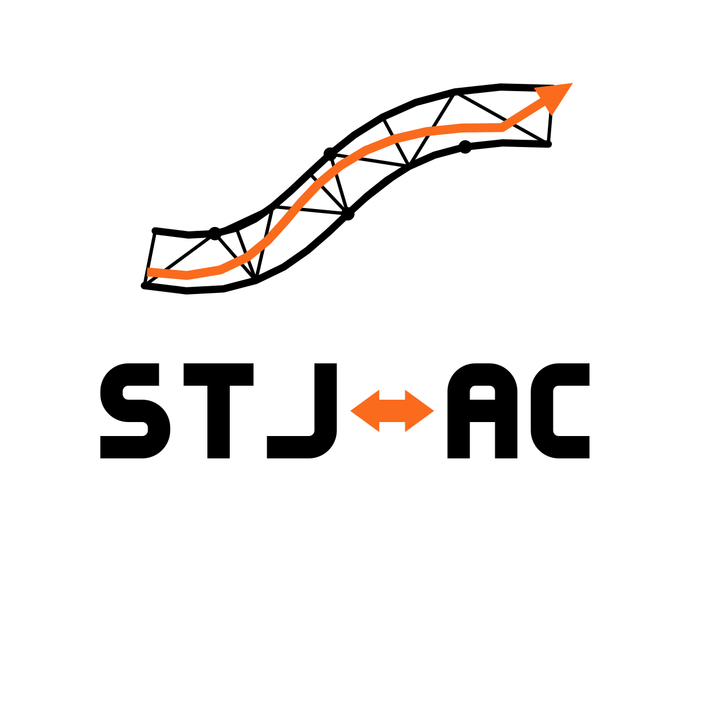

<p align="center">
  
</p>

<h1 align="center">ac-stj</h1>

<p align="center">
  <b>Assetto Corsa tracks to STJ and back.</b><br>
  AI lines, timing, cameras, sun and lights, kn5 meshes as OpenUSD.
</p>

<p align="center">
  <a href="LICENSE"></a>
  
  
  <a href="https://github.com/RFloEng/STJ-Standard-Track-Json"></a>
</p>

---

Bidirectional converter between Assetto Corsa (AC) track folders and
[STJ (Standard Track JSON)](https://github.com/RFloEng/STJ-Standard-Track-Json) v0.3.

> **Not affiliated with Kunos Simulazioni or the STJ project.** This repository contains no game content. It converts
> files you already own; the output is marked `redistributable: false` and is yours to check before sharing. See [Legal](#legal).

## Install and use
```
pip install numpy usd-core          # usd-core only for meshes; numpy for everything
python cli.py list   "<AC>/content/tracks"
python cli.py to-stj "<tracks>/ks_vallelunga" -o out            # every layout -> out/<track>_<layout>.stj.json (+ .conversion.json)
python cli.py to-ac  out/ks_vallelunga_classic_circuit.stj.json -o build   # -> build/<track>/ ready to copy into content/tracks
python -m unittest discover -s tests                            # needs AC installed (or set AC_TRACKS); skipped otherwise
```

Validation uses a clone of the STJ repo at `../stj-ref` (or set `STJ_REPO`; needs `jsonschema` and `usd-core`):
`python ../stj-ref/tools/validate.py out/*.stj.json`.

## Frames
AC (x right, y up, z) -> STJ (x, -z, y): a rotation, so track shape is preserved
(verified against `ui_track.json` `run` on all installed tracks). STJ `s` = AC AI distance (`chainage`).

## AC -> STJ
| AC source | STJ |
|---|---|
| `ai/fast_lane.ai` | `reference.centerline` (+chainage, `width_profile` from side_left/right), `race.racing_lines[race]` with speed |
| `ai/pit_lane.ai` | `race.racing_lines[pit]`, `timing.pit_lane` (entry/exit by projection; circuits only) |
| `data/surfaces.ini` | `surfaces.library` (FRICTION -> LMUX/LMUY marked `_est`, IS_VALID_TRACK, IS_PITLANE), one road band |
| kn5 `AC_START_n`, `AC_PIT_n`, `AC_HOTLAP_START_0` | `race.grid`, `race.pit_boxes`, `race.spawns` |
| kn5 `AC_TIME_n_L/R` | `timing.start_finish`, `timing.sectors` / `split_points` |
| `sections.ini`, `drs_zones.ini`, `cameras*.ini` | `race.sections`, `timing.drs_zones`, `cameras.sets` |
| `ui/**/ui_track.json` | `track_info` |
| everything else small (groove, lighting, ai_hints, ...) | verbatim in `x_assetto_corsa.files` |

Every loss/guess is listed in `<name>.conversion.json` (spec 3.12) and in `_metadata.provenance`.
Output is marked `redistributable: false`.

## STJ -> AC
Writes `ai/`, `data/` (surfaces, sections, drs, cameras, map.ini, restored raw files), `ui/`, `map.png`,
`models_<layout>.ini`, and **generated** `<name>.kn5` (AC_START/PIT/TIME nodes + flat-colour road ribbons) and
`1.kn5` (physics meshes `01<KEY>NNN`). Missing grid/pits are generated and reported.

## Meshes (kn5 <-> USD)
`to-stj ... --meshes [--no-textures]` converts the layout's kn5 files into `<track>_assets/meshes/*.usdc` and registers them in
`geometry.meshes`: collision meshes (`01ROAD001`, ...) go to `*.collision.usdc` with `STJ__surface__<id>` materials (AC built-in
surfaces such as ROAD/GRASS/WALL are added to `surfaces.library`); everything else is `*.visual.usdc` with UsdPreviewSurface
materials (diffuse, normal, alpha cut-out) and the original AC shader/parameters in `customData x_assetto_corsa`.
Textures are copied unchanged (DDS kept) to `<track>_assets/textures/`. `to-ac` rebuilds kn5 files from those USD files
(restoring the AC shaders and textures) and falls back to the generated ribbon when the document has no USD meshes.
Needs `usd-core`. 

## Lighting, cameras, shaders (added 2026-11-14)
- **Sun**: `lighting.ini` SUN_PITCH/HEADING -> `environment.lighting.sun.direction`. The heading convention (clockwise from AC +z) is an assumption; the raw angles are kept in `x_assetto_corsa` and written back unchanged. Not yet checked against in-game shadows.
- **CSP lights** (`extension/ext_config.ini` `[LIGHT_n]`) -> `environment.lighting.lights[]` (position, spot cone, range, night schedule). Colour -> colour temperature and brightness -> cd are estimates. Every original key stays per light; geo position -> `environment.geo_reference`. The rest of ext_config.ini is stored verbatim and restored.
- **Cameras**: every `cameras*.ini` key is kept (verified 0 diffs over all five files of the test track).
- **Mesh flags**: visible / cast-shadow / transparent / layer / LOD in-out are stored on each USD prim (`x_assetto_corsa`) and written back to the kn5. `AC_POBJECT_*` meshes are tagged `physics_object`; their behaviour is not described.
- **Shaders**: the original shader name, props and texture slots are kept per material and restored. `txMaps` G is read as gloss (roughness = 1 - G, assumed). `ksMultilayer*` also gets a MaterialX OpenPBR layer-blend network (txMask RGBA x tiled txDetailR/G/B/A x magicMult); it has not been rendered.

## Pacenotes (CSP Rally Copilot)
`data/*.rc-notes` <-> `race.pacenotes` (first file) and `race.pacenote_sets` (others). Turns, hairpins, straights (length), jumps/overcrests,
narrows, bridges and surface changes map to STJ kinds, Copilot hints (cut, long, tightens, caution...) to modifiers, positions
(fractions of the track) to `s`. AC's 1-6 turn scale (1 = hairpin) becomes kind `hairpin` plus severity 2-6; keep left/right and extras
map to kind `other`. Each item also stays in the note's `x_assetto_corsa`, and the file text is restored unchanged while the notes are unchanged.

## Not done yet (honest list)
- Shaders: detail normal maps, fresnel and reflection variants are only kept as data (not rendered in USD); the MaterialX network is untested;
  blended materials trigger the validator's "opacity without opacityThreshold" warning; no skinned meshes; LODs are kept as per-prim
  ranges, not as STJ `lods[]` prototypes; AC_POBJECT physics props and `KS_START_LIGHT` meshes are not mapped to scenery / `start_procedure.lights`.
- Sun heading convention, light colour/brightness conversion and the tracks rebuilt with lights/cameras are not yet verified in-game.
- Pacenotes: only hand-made `*.rc-notes` in the layout's `data` folder are converted. Notes Rally Copilot generates in game, or keeps in the
  user's config folder, are not. The `.rc-notes` text layout was taken from the app's source and tested on a synthetic file only; no real file was available.
- OpenDRIVE-only references, layouts/routes/variants, terrain, `ai_hints` mapping.

## In-game test (2026-11-13/14)
Vallelunga Classic, STJ -> AC with USD meshes and textures, installed as `stj_test_vallelunga`: loads in AC 1.x + CSP, renders with
original textures, car spawns in its pit box and rests on the surface, AI spline and pit spline load, 4 AI cars spawn at the pits
without errors in `log.txt`. Not yet checked: driven laps, AI lap behaviour, grip feel. Launch recipe: write `cfg/race.ini`
(TRACK, CONFIG_TRACK, CAR_0) and start `acs.exe` from the AC folder.

## Legal
GPL-3.0-or-later (see [LICENSE](LICENSE) and [NOTICE](NOTICE)), the same as stj2beamng. The logo is derived from the STJ logo, which is
Apache-2.0; Apache-2.0 material can be included in a GPL-3.0 project.
Dependencies are not bundled: numpy (BSD-3-Clause), usd-core/OpenUSD (Pixar, Apache-2.0 based), jsonschema (MIT, validator only).
Assetto Corsa and Kunos are trademarks of their owners. Tracks, textures and models belong to their authors: do not publish
converted tracks unless their licence allows it (a conversion report lists what was copied).
